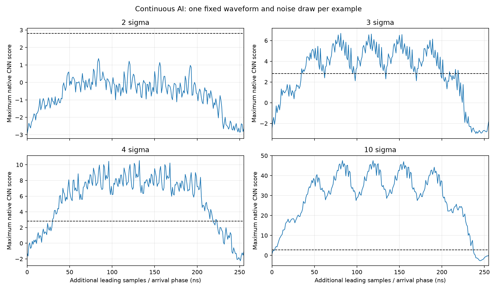
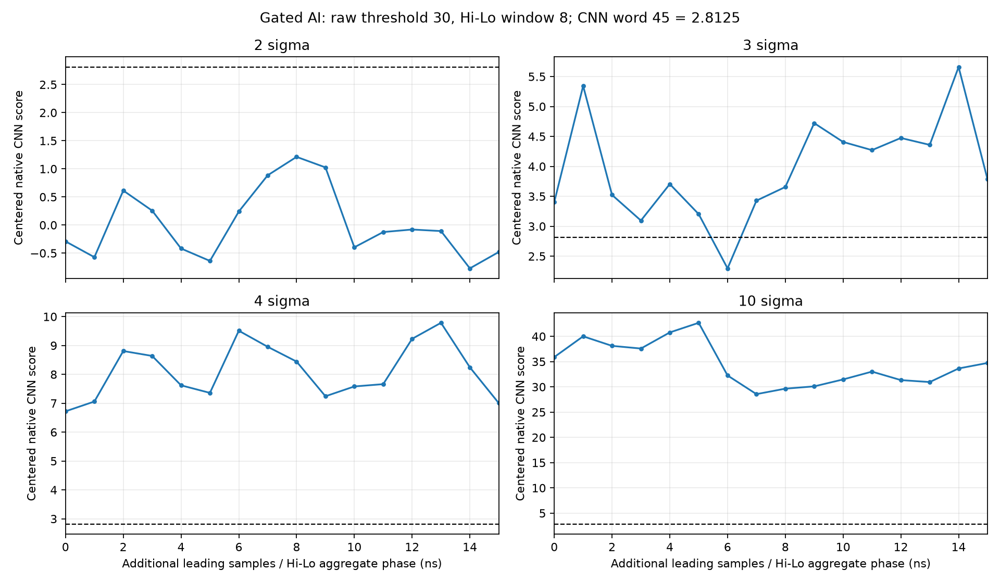
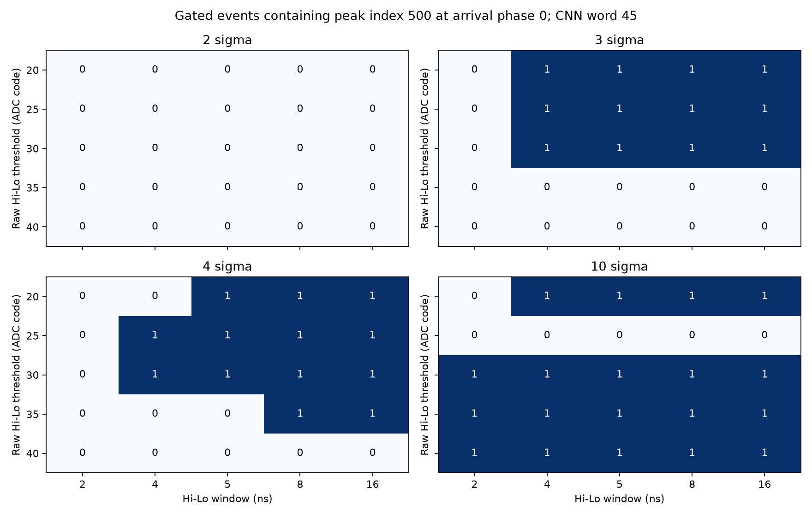

# Single-channel template simulation and scans, fixed CNN gain x6

Branch: `v3.6`. Sliding simulation source export: `3eca61e`; continuous-stream
scan driver: `f40d77e`; selectable Hi-Lo phase scan and final analysis: `7bf9480`.
Completed on 2026-10-05 (Asia/Taipei). Native CNN, Wrapper and Hi-Lo pins remain
`eca9b12`, `a82a717` and `047d14a`. Server: `100.71.11.92`, Vivado/Vitis HLS 2023.2.

Status: all 1536 main scenarios and 196 follow-up scenarios completed, with
independent numerical and raw-frame checks. Busy-path drops are measured below.

## Input and reference boundary

The input is the four examples in `data/noise_2mV_for_x480_Sep_30`: 2, 3, 4 and
10 sigma, each a distinct selected 3 m event with a distinct noise realization.
Each CSV has 1000 points at 1 ns, from -100 to 899 ns. The pulse peaks at index
500, or 400 ns. Only ADC/CNN channel zero is populated; all other channels are
zero. `channel_used` identifies the original simulated antenna, not the FPGA
input assignment. These are four selected examples of a 59-event set.

Physical voltages are converted with the existing 0.8 Vpp 12-bit ADC mapping.
Hi-Lo and the raw event path receive those codes directly. Gain six is applied
only at CNN ingress, followed by native symmetric saturation. CNN Core
Generator's already normalized test corpus and model weights are unchanged.
No samples in these four noisy examples clip at either boundary.

`input_audit.json` records amplitudes, full-record residual noise RMS and
input hashes. The `noise` stream variant is `noisy - noiseless` in volts,
followed by ADC quantization; it is not the subtraction of two quantized
records. The four residual records contain only 4 microseconds of noise.
Bench label files contain zero placeholders. Its printed accuracy and
throughput summaries are not physics efficiency or hardware-rate measurements;
this report uses native score words, complete frames and loss counters.

## Completed sliding scan

Four fresh isolated Vivado projects compile the Bender-locked native CNN and
actual XPM models. Each waveform is scanned with all 745 stride-one,
256-sample windows. Every one of the 2980 native score words matches the
supplied x480 `_scores.csv` bit for bit. Scores use signed low 21 bits with
unit 1/512. External threshold words use signed 32 bits with unit 1/16.
Word 45 is 2.8125, the nearest representable value to the supplied 2.807.
The comparison is strictly `score > threshold`.

| Example | Maximum native score | Windows over 2.8125 | Complete output events |
| --- | ---: | ---: | ---: |
| 2 sigma | 1.365234375 | 0 / 745 | 0 |
| 3 sigma | 6.697265625 | 163 / 745 | 163 |
| 4 sigma | 10.53125 | 191 / 745 | 191 |
| 10 sigma | 47.525390625 | 233 / 745 | 233 |

All 587 event frames contain exactly 64 beats. All 37,568 raw event beats
match the original ADC samples in their respective window, including zeros
on unused channels. Score, chunk, timestamp, framing and threshold acceptance
also match. All four runs report zero input/chunk overflows, dropped triggers,
ring misses and event loss. `sliding/raw_event_validation.json` records these
checks; compressed event CSVs retain the full evidence.

`sliding/threshold_scan.csv` sweeps 801 representable words, 0..800, or 0..50,
over the saved exact scores. `sliding/scan_summary.csv`, per-example annotated
scores and plots retain both values and window positions. The 587 repeated
windows are not 587 independent neutrino events. Adjacent windows share
255 of 256 samples; their over-threshold fraction is an observed window
fraction, not a population efficiency, independent-event probability or Hz.

## Continuous-stream scan design

`scripts/run_template_stream_scan.py` uses the existing bench without changing
RTL or testbench. It clones the compiled XSim snapshot into private workers,
starts a new simulator process and reset per scenario, and checks compiled
system source hashes against its source export. The independent qualified HLS
engine and weights are copied into new scratch storage, leaving its original
reference artifacts intact.

Inputs contain the complete waveform once, with at least 256 leading and
256 trailing zero samples, rounded to whole chunks. Adding `phase` leading
samples changes arrival alignment without scaling or reordering the waveform.
Continuous AI expects one score per chunk. Hi-Lo-only expects no CNN work.
Gated AI checks each accepted centered event against its raw window and HLS
score. Centered start is `256 * timestamp + 4 * trigger_offset - 124` in the
normalized stream. Original waveform coordinates are also retained.

The 1536-scenario plan covers noisy/noiseless/residual baseline streams;
256 continuous-AI arrival phases; 16 Hi-Lo aggregate phases; and raw thresholds
20, 25, 30, 35, 40 crossed with Hi-Lo windows 2, 4, 5, 8, 16. `BIN_THR=1` and
`COINC_WINDOW=3` are fixed. Gated AI runs at word 45 and at the minimum external
threshold word to retain every admitted CNN window. A zero-event result must
be separated into no Hi-Lo admission, CNN rejection, and busy-path loss.

Hi-Lo dropped requests and the sticky event-loss bit are reported rather than
treated as a numerical mismatch. Input/chunk overflows and ring misses fail
the scan. The 1 us records do not exercise long-run rate blanking or establish
sustained hardware throughput.

The score CSV gives a gated start chunk but no beat offset for rejected work.
Rejected scores are compared with every feasible four-sample-aligned window
in that chunk; equal quantized scores can leave the input position ambiguous.
Those ambiguities are explicitly counted. Accepted raw-event windows and
continuous chunks have exact positions and independent HLS comparisons.

## Completed stream scans and observations

| Check | Main scan | Follow-up, raw threshold 30 / window 8 |
| --- | ---: | ---: |
| Scenarios completed | 1536 | 196 |
| Saved native CNN results | 7316 | 152 |
| Exact-position HLS score comparisons | 7276 | 135 |
| Rejected scores matching feasible windows | 40 | 17 |
| Rejected scores with ambiguous input positions | 8 | 0 |
| Complete raw event frames checked | 847 | 175 |
| Raw event beats checked | 54,208 | 11,200 |
| Distinct raw windows evaluated by HLS | 5043 | 392 |

The follow-up includes 16 phases for modes 3 and 4, both gated CNN thresholds,
and one baseline continuous run per example, for 49 scenarios per example.
Local analysis regenerates every input manifest, compares it byte for byte
with the server manifest, checks every raw frame again, and reruns both scans'
HLS comparisons with the qualified local executable. All counts and scores
match the server. See `stream/local_reanalysis.json` and
`gated_phase/local_reanalysis.json`.

The following counts describe arrival phases of one fixed waveform and one
fixed noise realization. CNN word 45 is used throughout. A firing phase means
at least one complete event, not an independent noise draw or physical event.

| Example | Continuous firing / 256 | Continuous peak present / 256 | Gated 35 / 5 firing / 16 | Gated 30 / 8 firing / 16 |
| --- | ---: | ---: | ---: | ---: |
| 2 sigma | 0 | 0 | 0 | 0 |
| 3 sigma | 163 | 163 | 0 | 15 |
| 4 sigma | 191 | 191 | 0 | 16 |
| 10 sigma | 233 | 225 | 16 | 16 |

All firing phases in the selected gated 30 / 8 scan contain peak index 500.
`phase_comparison.csv` records both firing and peak coverage, so a CNN trigger
is not assumed to retain the main pulse peak. At continuous phase zero the
peak is at sample 244 of its chunk; all four examples fail word 45. The 10-sigma
maximum score there is only 0.537109375, despite the sliding maximum of
47.525390625. In phases 4..11 its accepted continuous frame starts at original
indices 508..501, retaining the pulse tail while excluding the main peak.

The baseline Hi-Lo settings 35 / 5 admit no CNN work for the 2-, 3- or 4-sigma
noisy examples, including the 16 tested aggregate phases. Threshold 30 means
5.859375 mV in raw ADC units; changing to 30 / 8 admits one centered window
per phase in all four examples. The 3-sigma native scores span
2.296875..5.66015625; phase 6 fails word 45 after successful raw admission.
Its remaining phase gap therefore comes from CNN rejection. From these saved
scores, word 36 (2.25) would accept all 16 admitted 3-sigma windows with the
same inputs. This is an inferred bench setting, not a tested word-36 run or a
noise-rate calibration. The 2-sigma gated scores span -0.771484375..1.212890625
and all fail word 45.

The phase-zero threshold/window grid is not monotonic in raw threshold.
For example, the 10-sigma 25 / 4 run admits a window starting at source index
96, ending at 351, with native score -3.123046875; it excludes the peak at 500
and reports four busy-path drops. The 30 / 8 run admits the window 368..623,
scores 35.900390625 and captures the peak. A more permissive raw setting can
therefore admit earlier work and prevent later useful requests from entering.
The selected 30 / 8 setting is useful for comparing these examples on the
bench; it is not a population-optimal operating point.

`hilo_grid.csv` retains raw-only and gated counts, peak coverage, scores and
drops; `baseline_comparison.csv` retains noisy/noiseless/residual controls.
Noiseless and residual controls at phase zero do not characterize all phases.
The residual-noise controls have no events at word 45 under baseline 35 / 5.
Calibrating a one-channel background threshold needs longer independent noise
records; measuring efficiency needs the full event set and multiple noise draws.

All 1732 runs have the requested active mode, valid configuration, zero input
and chunk overflows, and zero ring misses. Numerical/frame checks pass, while
219 main scenarios and 132 follow-up scenarios report busy-path drops and
sticky event loss; the maximum is 32 and 4 dropped requests in one run,
respectively. `protocol_health.json` records those counts. Final blanking flags
are zero, but these short inputs do not measure sustained rate blanking.

`stream/native_results.tar.gz` and `gated_phase/native_results.tar.gz` contain
every score/event CSV, input manifest, simulation log, command, per-run summary,
rejected-score match list, full run plan, HLS raw-window reference and file hashes.
The archives omit compiled workers, generated hex and reference binaries.
Each `artifact_index.json` records the archive checksum, captured row counts
and the actual launch command. Simulator result/event counters match saved
CSV rows for every scenario. Local copies verify every archived file checksum.

## Provenance and reproduction

Use the commands under the repository README's scan section. The source
archive checksums are in `sliding_source_snapshot.json`,
`stream_source_snapshot.json` and `gated_phase_source_snapshot.json`;
`sliding_source_export.json` records the actual
archive root commit and dependency pins. The archives omit `.git`; the original
sliding runtime's unavailable Git fields are not used as provenance. Four
compiled file lists match, as recorded in `sliding/source_parity.json`.

Server sliding artifacts:
`/home/work1/Works/_codex_template_scan_x6_20261004_3eca61e/build/template_scan_x6_20261004/sliding`.
Server stream artifacts:
`/home/work1/Works/_codex_template_stream_x6_20261004_f40d77e/build/full_scan`.
Server follow-up artifacts:
`/home/work1/Works/_codex_template_stream_x6_20261004_7bf9480/build/gated_phase_scan`.
Heavy projects, generated input hex, reference binaries and full runtime outputs
remain in ignored local/server `build/` directories.

The 105-test local Python suite passes using the existing Homebrew Python
environment with NumPy and Matplotlib. Production HDL is unchanged by the
scan commits, so routed OOC timing remains the source-matched result in
`../fixed_cnn_gain_x6_20261004/README.md`; this scan is not a new routed run or
board qualification.
`routed_source_parity.json` records the compiled-source comparison with that
routed OOC manifest.

TDD red/green and regression logs are retained in `tdd_logs.tar.gz`.
`SHA256.json` covers all files in this qualification directory.
